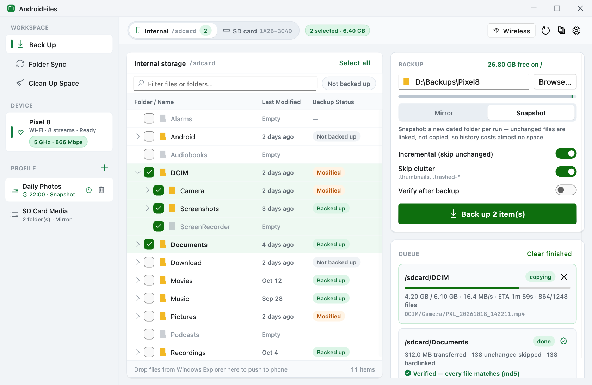
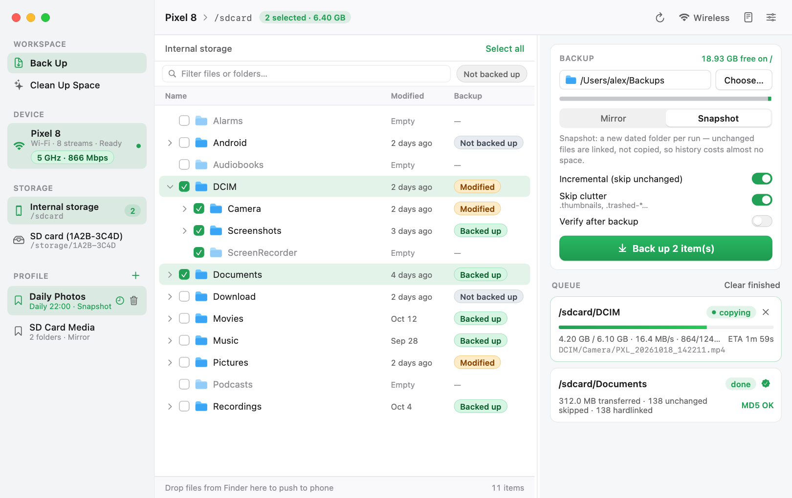

# AndroidFiles

**Fast, reliable Android phone backups for Windows & macOS — over ADB, not MTP.**

[](https://github.com/mnow-dev/AndroidFiles/releases/latest)
[](https://github.com/mnow-dev/AndroidFiles/releases)
[](https://github.com/mnow-dev/AndroidFiles/actions/workflows/ci.yml)
[](LICENSE)


#### Windows (Windows 10 & 11)


#### macOS (Apple Silicon & Intel)


Built-in phone access (MTP on Windows, or third-party MTP tools on macOS)
copies file-by-file, stalls on large folders, and gives up halfway.
AndroidFiles streams whole folders off your phone as a single continuous
transfer over ADB — saturating the USB link — and verifies what landed.

## Features

- **Fast backups** — folders stream as one tar pipe (`adb exec-out tar`),
  no per-file round-trips; typically several times faster than MTP for
  large folders, with live progress, speed, ETA, and pause/resume
- **Internal storage & external microSD cards** — browse, back up, clean
  up, or mount internal `/sdcard` and any mounted external microSD card
  (`/storage/<UUID>`) without removing the SIM tray; external card backups
  are kept cleanly separated in `SD-<UUID>/` subfolders
- **Incremental** — re-runs transfer only changed files (size+mtime
  manifest diff); an unchanged 50 GB folder re-backs-up in seconds moving
  0 bytes
- **Skip clutter** (optional, off by default) — prune regenerable
  caches and system cruft (`.thumbnails`, `LOST.DIR`, `Android/data`, …)
  so they never leave the phone; the glob list is editable in Settings
- **Mirror or Snapshot layouts** — keep one up-to-date copy, or a dated
  folder per run where unchanged files are hardlinked (NTFS on Windows,
  APFS/HFS+ on macOS — full history at almost no extra disk cost)
- **Verified** — file counts checked after every run; optional deep verify
  compares md5 of every file on both sides
- **Quick Look previews** — press `Space`, double-click, or click the eye icon
  on any file in **Device Folders** or **Clean Up Space** to preview photos
  (including HEIC), videos, multi-page PDFs, Markdown, HTML, JSON, and text/code
  in a separate resizable window (native `QLPreviewView` on macOS, lightbox +
  Pop Out window on Windows); backed-up files open instantly from local disk
- **Clean Up Space** — analyze phone storage, inspect largest
  folders & files, view per-app **Static APK / App Data / Reclaimable Cache**
  with one-click **Trim All Caches**, find exact MD5 duplicates, and act on smart
  proposals (e.g. DCIM videos only, keep last 3/6/12 months, already backed-up
  downloads) with optional **Back up first + verify MD5** before deleting
- **Explorer drive (Windows)** — mount the phone as a drive letter (WinFsp)
  and it opens in File Explorer for browsing and grabbing files; optional
  writable mode (off by default, guarded by a warning)
- **Restore** — drag files from Explorer or Finder onto the app to push
  them back to the phone
- **Profiles & scheduling** — save folder selections, re-run in one click,
  or schedule daily backups via Windows Task Scheduler or macOS `launchd`
  with desktop notifications
- **Space at a glance** — the destination drive's free space and the total
  size of your current selection show under the destination as you tick folders
- **11 languages** — English, Spanish, German, French, Italian, Portuguese,
  Polish, Ukrainian, Japanese, Korean, and Chinese; follows your OS by
  default or pick one in Settings
- **Wireless** — pair by scanning a QR code (like Android Studio);
  already-paired phones on your network reconnect automatically (with
  native Bonjour discovery on macOS), and the sidebar shows live Wi-Fi band
  and link speed (`5 GHz` vs `2.4 GHz`). Wireless transfers are split across
  8 parallel streams, about 3x faster than a single adb stream over Wi-Fi
- **Self-contained** — if adb isn't installed, the app downloads Google's
  platform-tools automatically
- **Correct with non-ASCII filenames** — tar extraction is done natively
  (avoiding platform tar UTF-8 quirks)

## Install

**Installer (recommended):** download `AndroidFiles-win-Setup.exe` from
[Releases](../../releases/latest) and run it. It installs per-user (no admin
prompt) and updates itself from GitHub — when a new version ships, the app
offers to download and apply it in place. (On v0.1.3 or v0.1.4, if clicking
**Update** does nothing, close the app, run `adb kill-server`, and run the new
Setup.exe once; from v0.1.5 on, in-app updates work again.)

**Portable:** prefer no installer? Grab the ZIP from the same page, extract it
anywhere, and run `android_files.exe`. Portable builds don't self-update, but
the app still tells you when a new version is out.

Then, on the phone: enable **Developer options → USB debugging**, plug in, and
accept the prompt. (Or pair wirelessly via the Wi-Fi button — no cable.)

**Notes**

- Windows SmartScreen may warn on first run because the binaries are not
  code-signed (see [Code signing](#code-signing)). Click
  *More info → Run anyway*.
- The **Explorer drive** feature additionally needs the free
  [WinFsp](https://winfsp.dev/rel/) driver installed. Everything else works
  without it.
- adb is bundled-on-demand: if missing, it is downloaded from Google on
  first start.
- On launch the app asks GitHub whether a newer release exists. In an
  installed build it offers to download and apply the update in place (via
  [Velopack](https://velopack.io/)); the portable build just links you to the
  release. Turn the check off under **Settings → Check GitHub for new versions
  on launch**.

### macOS

AndroidFiles runs natively on macOS (Apple silicon and Intel) with a
dedicated macOS 3-pane Finder & Inspector UI, native menu bar shortcuts
(`⌘1`/`⌘2` workspaces, `⌘B` backup, `⌘,` settings), and the **Clean Up
Space** workspace. Download `AndroidFiles-v*-macos.dmg` from
[Releases](../../releases/latest) and drag `AndroidFiles.app`
to Applications, or build from source (see [Building from source](#building-from-source)).
Backups, incremental runs, external microSD cards, snapshots, verify, restore,
wireless pairing (via native Bonjour), profiles, and scheduling all work as on
Windows; the WinFsp Explorer drive and Velopack in-app updates are Windows-only.
On a Mac:

- adb is taken from Homebrew or Android Studio if installed, otherwise
  downloaded from Google as on Windows. No USB driver is needed.
- Back up to any folder, including an external drive under `/Volumes`. If
  that drive isn't plugged in, the app says so and won't start (rather than
  writing to the Mac's own disk). NTFS drives are read-only on macOS; use
  APFS, Mac OS Extended or exFAT.
- Snapshot mode hardlinks unchanged files on APFS/Mac OS Extended; on exFAT
  it copies them instead (works, but costs the full space each run).
- The Mac is kept from idle-sleeping while a backup runs (the display may
  still turn off). Closing a laptop's lid still puts it to sleep.
- Scheduled backups are registered with launchd as LaunchAgents in
  `~/Library/LaunchAgents`.

## Quick start

1. Tick the folders to back up in the tree on the left.
2. Pick a destination folder on your PC.
3. Press **Back up**. That's it — re-running later only transfers changes.

For a walkthrough of every feature, see the
**[User guide](https://mnow-dev.github.io/AndroidFiles/guide.html)**.

## Status

AndroidFiles is early software (v0.3.0) and in active use, but it reads
from — and, in writable-drive and restore modes, writes to — your phone.
**Keep at least one independent backup of anything you can't afford to lose**,
and leave the Explorer drive read-only unless you specifically need to change
files on the device. Provided as-is, with no warranty (see [LICENSE](LICENSE)).

## Code signing

AndroidFiles is free and MIT-licensed. Releases are not code-signed yet, which
is why Windows SmartScreen warns the first time you run it.

Signing is worth doing, but not for the reason it's usually sold: Microsoft is
explicit that a certificate does not make the warning disappear on its own —
a new signed app is still "unrecognized" until it builds reputation. What
signing buys is that the reputation *accumulates across releases* instead of
resetting to zero with every new version, the way it does for unsigned builds.

Sorting this out is on the list — [SignPath Foundation](https://signpath.org/)
signs open-source projects for free, and there are cheap certificates if that
doesn't work out. This section will say something concrete once it is.

## Building from source

Prereqs: [Flutter](https://flutter.dev) (stable), Visual Studio 2022 Build
Tools with the C++ workload, and — for the drive host — the
[.NET SDK 9](https://dotnet.microsoft.com/) plus [WinFsp](https://winfsp.dev/rel/)
(its installer provides the .NET binding the build references).

```powershell
flutter pub get
flutter build windows --release
dotnet publish drive -c Release -o drive\publish   # optional: Explorer drive host
```

On macOS you need Flutter, Xcode and [CocoaPods](https://cocoapods.org):

```sh
flutter pub get
flutter build macos --release   # → build/macos/Build/Products/Release/AndroidFiles.app
```

The Mac app isn't sandboxed (it runs adb and writes wherever you point it),
and a local build isn't notarized. That only matters if you hand the `.app`
to someone else: their Mac will block it until they allow it under
*System Settings → Privacy & Security → Open Anyway*.

Run the tests with `flutter test`. There is also a live end-to-end suite
(`flutter test test/live_backup_manual.dart`) that exercises real transfers
against a connected device using a throwaway folder.

Note: `third_party/fluent_ui` is a vendored copy of
[fluent_ui](https://pub.dev/packages/fluent_ui) (BSD-3) carrying a small
crash fix in the ComboBox popup; `pubspec.yaml` overrides the dependency to
it. Project notes and the roadmap live in [NOTES.md](NOTES.md).

## License

[MIT](LICENSE). Bundles [fluent_ui](https://pub.dev/packages/fluent_ui)
(BSD-3-Clause, vendored under `third_party/`). The optional Explorer-drive
feature uses [WinFsp](https://winfsp.dev) (GPLv3 with FLOSS exception),
which users install separately.
